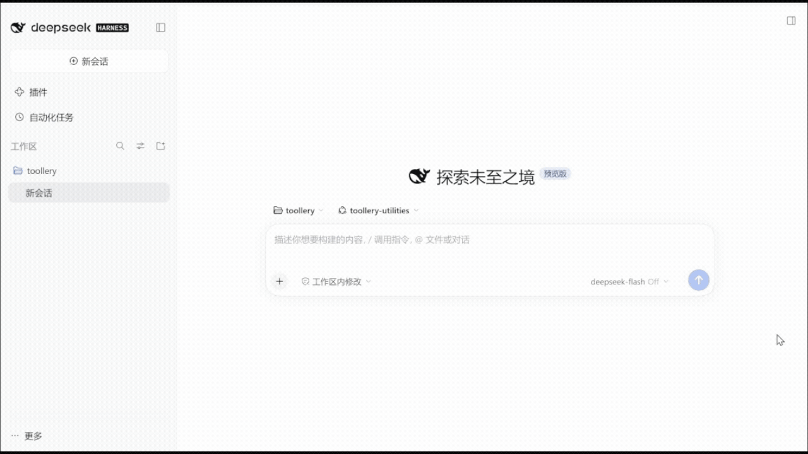
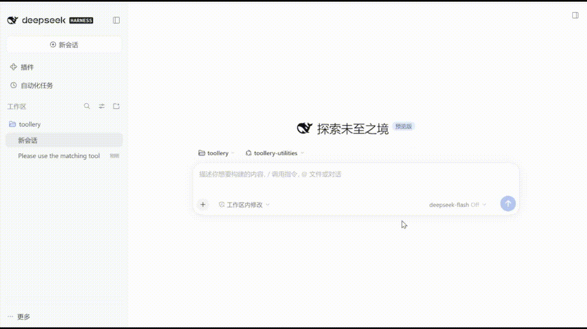

# Toollery for DeepSeek Harness

An independent implementation of [Toollery](https://arxiv.org/abs/2609.22218) for [DeepSeek Harness (DSH)](https://github.com/deepseek-ai/deepseek-harness). Generate three proxy queries per tool, cache them locally, and retrieve a smaller tool set for each user turn.

This project implements an existing method, not an original algorithm. It is not affiliated with or endorsed by the Toollery authors or the DSH team. Original repository: [XiangxiTian/toollery](https://github.com/XiangxiTian/toollery). The manual-generation prompt follows Appendix A.1; see [Acknowledgements](ACKNOWLEDGEMENTS.md).

## What it does

- Discovers the complete tool pool visible to a DSH agent after configured sources finish loading.
- Validates cached manuals, prepares the initial pool with consent, and refreshes small later cache misses under the configured generation policy.
- Searches `spec`, `manual`, or `spec_manual` with local BM25.
- Sends selected tools' **original schemas** to the chat model. Manuals stay in the local search index.
- Provides an ON/OFF switch, retrieval settings and per-turn selected/called tool cards in the official DSH Web UI.
- Supports the bundled 12-tool demo, a filesystem MCP preset, and configured MCP or Cordis sources.

After preparation, the default is **ON / spec_manual / top_k / k=3**. OFF bypasses retrieval and retains the host-allowed tool pool. `all` retains every tool but can still rank them using the selected representation.

## Install and try it

### Plugin for your existing DSH

The v0.2 plugin uses your existing DSH Desktop profile, chat model and registered tools; no second DSH installation is needed. The local target is **DSH Desktop 0.12.1**, with a working chat model and native tool presentation (Standard preset). The DSH runtime is pinned separately to **0.2.1-rc.2**.

In DSH Desktop, open **Plugins → Add plugin** and enter the npm package name:

```text
@jkl-agents/dsh-toollery
```

DSH resolves and installs the current npm release. If you prefer a pinned or offline install, download the matching `.tgz` asset from the [latest GitHub release](https://github.com/JKL-agents/toollery-dsh/releases/latest), or use the CLI command shown in the [plugin guide](docs/plugin.md).

1. If you are using the npm path above, DSH shows the package inspection result and installs it from the configured registry. For a pinned/offline archive, open **Plugins → Add plugin → Install a third-party plugin**, paste the downloaded file's **absolute path** (or a release asset URL), install, enable it, and restart if DSH requests it. Desktop supplies its own Node/package manager.
2. Open Toollery's plugin details. Select **Set up local worker**. If Python 3.12+ is unavailable, Windows x64 users can allow a **private Python download** first. This does not install another DSH or call a model.
3. In **Manual-generation model**, enter the model, OpenAI-compatible API base URL and key, then save. These settings are independent of DSH's chat model. The key stays in local profile storage and is not returned to the form.
4. Start a **new native conversation**. Review its tool count and missing-manual count, allow generation charges, then select **Generate missing manuals (uses API)**. Each tool gets three proxy queries; valid cached entries are reused.
5. Once ready, ask a prompt that uses one of your existing tools. Inspect the selected/called tool cards, adjust k, or switch OFF. Settings apply to the next turn; an explicit OFF choice stays OFF when preparation finishes.

No terminal, `.env` editing or standalone launcher is needed for this path. On platforms other than Windows x64, install Python 3.12+ with venv/pip before worker setup. Initial generation needs provider access and can take time for large pools. See the [verification summary](docs/verification.md) for the current Desktop validation boundary.

OFF bypasses retrieval while respecting DSH/other plugins' tool restrictions. ON requires a healthy worker and prepared cache. On a later user turn, the plugin detects registered tool additions, removals and schema changes without restarting. Up to 15 missing manuals are generated automatically by default; larger updates require approval, followed by resubmitting the message. The panel shows progress, elapsed time and an approximate ETA. Native root conversations are supported; PTC and subagent retrieval are outside this version's scope.

See the [plugin guide](docs/plugin.md) for setup, upgrades, removal and compatibility boundaries. The Windows launcher below remains a **standalone demo**, with a private DSH environment for users who want to try the behavior first.

### Standalone Windows demo: free preview, no API key

**Requires Windows x64, a writable folder and internet access.** Python, Node.js, pnpm and DSH are installed privately; no administrator rights or preinstalled development tools are needed.

**[Download the latest release](https://github.com/JKL-agents/toollery-dsh/releases/latest)** and select **Source code (zip)**. Extract it to use the double-click launcher. This link always opens the latest published release.

For fixes not yet included in a release, download the [development ZIP from main](https://github.com/JKL-agents/toollery-dsh/archive/refs/heads/main.zip). It may contain unreleased changes.

1. Extract the ZIP, open the extracted repository folder, and double-click **`Start-Toollery.cmd`**. Run it from the extracted folder, not inside the ZIP.
2. Keep the terminal open while dependencies install. First use may take several minutes; the browser setup page opens when installation finishes. If it does not open, copy the full **`Toollery setup:`** URL printed in the terminal into your browser.
3. Select **12 utility tools**, check **Scripted preview — no API key or charges**, and leave retrieval at **ON / Spec + manual / top-k / k=3**. No API credentials are required.
4. Select **Start demo** and wait for the DSH page to open. If the new tab is blocked, select **Open DSH demo** on the setup page. Accept DSH's first-run notice if shown; use the workspace picker if the workspace does not open automatically.
5. Send this prompt:

   ```text
   Use add_numbers to add 19 and 23.
   ```

You should see `add_numbers` called and the result **42**. Change k or switch Toollery OFF, then repeat the prompt to compare selected tools. Another supported prompt is `Use celsius_to_fahrenheit to convert 20 Celsius.`

This free preview executes real DSH tools with a scripted model and mock manuals. It supports the example requests, not arbitrary chat, and makes no paid API requests.

The launcher creates a **standalone demo with its own DSH environment**. For an existing DSH installation, use the plugin above.

### Use your own chat and manual-generation models

1. On the setup page, stop any running demo and uncheck **Scripted preview**. Start with **12 utility tools**; the filesystem and custom pools are described in the [launcher guide](docs/launcher.md).
2. Enter your chat model, API base URL and key. Chat requires a DSH-compatible DeepSeek Messages API. The defaults are `deepseek-flash` and `https://api.deepseek.com/anthropic`.
3. Manual generation uses an OpenAI Chat Completions-compatible API, defaulting to `deepseek-flash` and `https://api.deepseek.com`. Expand **Separate manual-generation model or key** to use a different provider, model or key. Initially, the chat key is reused unless you supply a separate manual key.
4. For first real use with Toollery ON, check **Allow API calls to generate missing or stale manuals**, then select **Start demo**. Preparation finishes before the DSH chat opens.

**There are two separate sources of API usage:** generating missing or stale manuals during preparation, and calling the chat model during conversations. Valid cached manuals are reused on later starts. Scripted-preview manuals are isolated and do not replace real manuals. OFF bypasses manual preparation; turning ON later requires a valid cache or generation permission.

Credentials are saved locally in `.toollery-launcher/workspace/.env`. Blank key fields retain previously saved keys. For separate credentials, removal of saved keys and custom configurations, see the [launcher guide](docs/launcher.md#real-models-and-manual-generation).

### Stop, restart and troubleshoot

- **Stop:** select **Stop demo** on the setup page; press Ctrl+C in the terminal to close the launcher too. Closing a browser tab alone does not stop the processes.
- **Next time:** double-click the same **`Start-Toollery.cmd`** again. Dependencies, settings and valid manuals are reused. Each demo start creates a fresh DSH session; chat history is not resumed.
- **Ports:** DSH defaults to **3080** and uses a free localhost port if busy. Use the opened or displayed authenticated URL; the setup page has a separate port.
- **Installation failed:** check the terminal message and retry. First use needs access to GitHub, nodejs.org, PyPI and the npm registry. See [launcher troubleshooting](docs/launcher.md#script-options-and-troubleshooting) for blocked scripts and download failures.

### DSH Web UI demos

**Change k and try a different prompt.** Start with an addition request at k=3, then change k to 5 and ask for a temperature conversion. Each turn shows the retrieved candidates and actual tool calls.



**Switch OFF during a conversation.** Disable Toollery and repeat the request. The next turn bypasses retrieval and makes all 12 tools available. The k setting is retained but has no effect while Toollery is OFF.



Both recordings use the bundled 12-tool demo. Settings apply to the next turn; they do not change a turn already in progress.

## Manual standalone demo installation

### Prerequisites

The Windows double-click launcher above installs its own dependencies. For manual installation, prepare:

- Python 3.12 or later; Python 3.12.7 was tested on Windows.
- Node.js 22.19+ on the 22.x line, or 24+, for Web and the filesystem preset. Node 23 is unsupported. pnpm 11.x is required to install the pinned Web/MCP runtime, but not to run it afterward. Node 24.19 / pnpm 11.25 were tested.
- For real model use, a chat API compatible with DSH's configured DeepSeek Messages provider, and an OpenAI Chat Completions-compatible API for manuals. Defaults use `deepseek-flash` for both; these settings are independent.

DSH is pinned to Python `0.2.1rc2` / npm `0.2.1-rc.2`. Windows is verified; Linux and macOS are not yet verified. The DSH plugin is distributed through npm and GitHub releases; the Python package is not published to PyPI.

Install [Python](https://www.python.org/downloads/), [Node.js](https://nodejs.org/en/download) and [pnpm](https://pnpm.io/installation) as needed. After installation, reopen PowerShell and check `node --version` and `pnpm --version` **in the terminal you will use to launch Web**. An IDE or coding agent may have its own tools on PATH; that does not make them available in a normal terminal. The bundled terminal demo uses the Python SDK runtime and does not require a separate Node/pnpm installation. Configured MCP servers may require additional executables.

### Terminal setup

These commands use PowerShell. Activation is optional; use the environment's executables directly if activation is restricted.

```powershell
git clone https://github.com/JKL-agents/toollery-dsh.git
cd toollery-dsh
py -3.12 -m venv .venv
& .venv/Scripts/python.exe -m pip install ".[demo]"
& .venv/Scripts/toollery-dsh.exe init my-workspace
& .venv/Scripts/toollery-dsh.exe doctor --config my-workspace/toollery.json
```

Verify the real DSH bridge with a scripted model and mock manuals, without API credentials or charges:

```powershell
& .venv/Scripts/toollery-dsh.exe chat --config my-workspace/toollery.json --offline-smoke
```

For real use, copy the template, fill credentials locally, and prepare manuals:

```powershell
Copy-Item my-workspace/.env.example my-workspace/.env
# Edit my-workspace/.env: set TOOLLERY_API_KEY, or separate chat/manual keys.
& .venv/Scripts/toollery-dsh.exe prepare --config my-workspace/toollery.json
& .venv/Scripts/toollery-dsh.exe chat --config my-workspace/toollery.json
```

`prepare` makes paid API calls for missing/stale manuals. Normal `chat`/`web` startup only reads the manual cache; chatting still uses your paid chat API. `--generate-manuals` explicitly permits startup generation. Existing valid entries are reused.

## Official Web UI

```powershell
& .venv/Scripts/toollery-dsh.exe setup-web --config my-workspace/toollery.json
& .venv/Scripts/toollery-dsh.exe doctor --config my-workspace/toollery.json --require-web
& .venv/Scripts/toollery-dsh.exe web --config my-workspace/toollery.json --port 3080
```

Open the authenticated `dsh web:` URL printed by DSH **including its `?token=...`**, select a workspace, and start a conversation. The composer shows the switch and retrieval controls. Changes apply to the next turn; a turn's subset stays fixed through its tool calls. Cards show the full pool, selected tools and actual calls. Stop with Ctrl+C. The launcher binds to `127.0.0.1`.

Try “Please use the matching tool to add 19 and 23,” then “Convert 20 degrees Celsius to Fahrenheit using a tool.” Change k or switch OFF to inspect tool availability. These examples are not benchmark evidence.

Web commands: `/toollery status`, `/toollery on`, `/toollery off`, `/toollery mode spec_manual`, `/toollery budget top_k`, `/toollery k 3`. Terminal equivalents: `/on`, `/off`, `/mode`, `/budget`, `/k`, `/tools`, `/quit`.

## Real filesystem tools

```powershell
& .venv/Scripts/toollery-dsh.exe init filesystem-demo --preset filesystem
& .venv/Scripts/toollery-dsh.exe setup-web --config filesystem-demo/toollery.json
Copy-Item filesystem-demo/.env.example filesystem-demo/.env
# Fill credentials locally.
& .venv/Scripts/toollery-dsh.exe prepare --config filesystem-demo/toollery.json
& .venv/Scripts/toollery-dsh.exe web --config filesystem-demo/toollery.json
```

The allowed directory is `filesystem-demo/playground`, created by `init`. Ask the assistant to read its `welcome.txt`, using the absolute path if needed. Change `tool_sources[0].root` to select another allowed directory. Filesystem operations execute for real within that directory.

## Configuration and integration

`init` creates JSON configuration, `.env.example` and `.gitignore` without overwriting files. Paths resolve against the config directory. Chat/manual generation may use different models, endpoints and keys.

- [Existing DSH plugin installation](docs/plugin.md)
- [Configuration and cache](docs/configuration.md)
- [Tool sources and existing DSH integration](docs/integration.md)
- [Troubleshooting](docs/troubleshooting.md)
- [Windows launcher](docs/launcher.md)
- [Changelog](CHANGELOG.md) and [maintainer publishing checklist](docs/publishing.md)

## Evidence and limitations

- [Verification summary](docs/verification.md): installation, DSH integration and Web UI checks.
- [Experiment summary](docs/experiments/README.md): ToolRet retrieval gains, ToolTalk execution tradeoffs and preparation cost.

On our **ToolRet development subset** (10,656 tools / 5,679 queries), Recall@3 was 32.52% with specs and 37.23% with spec+manual; Recall@10 was 42.00% and 48.48%. This is documented subset evaluation, not reproduction of the paper's experiments.

The **ToolTalk executable supplement** exposed a limitation: latest-query top-3 retrieval reduced tokens but missed tools needed by follow-ups and dependencies. Strict adapted turn success fell from 67/79 OFF to 51/79 ON. Token reduction does not imply equal quality or universal latency improvement. See the report for protocols and denominators.

Retrieval uses lexical BM25 and the latest user text. There is no history-aware rewriting, dependency expansion or recovery search. Each user turn freezes its settings and selection across all model steps. The plugin reconciles the agent's visible registry at the first assembly of a later turn, then selects only within the host-eligible assembly. A restricted tool may have a cached manual without becoming callable. A removed tool is never restored by a frozen selection; implementation changes with an unchanged public schema remain outside the cache boundary. Optional provider-owned discovery ranks external candidate batches but does not autonomously discover, authorize or register tools. A larger k or OFF may suit tasks requiring broader access. Plugin checks are recorded separately from the earlier benchmark experiments.

## Development and layout

```text
toollery/             Preparation, cache, retrieval and metrics
  adapters/dsh.py     Authenticated localhost bridge
toollery_dsh/         Installable CLI, configuration and launchers
  assets/            Cordis plugins, UI and pinned runtime manifests
plugin/              Existing-profile plugin, worker lifecycle and bundle metadata
examples/            Source-checkout configuration examples
scripts/             Optional benchmark and verification drivers
tests/               Offline unit, transport and plugin tests
docs/                User guides, experiment evidence and release drafts
```

```powershell
& .venv/Scripts/python.exe -m pip install -e '.[dev,demo]'
& .venv/Scripts/python.exe -m unittest discover -s tests -v
node --test tests/test_dsh_snapshot.mjs tests/test_dsh_sources.mjs tests/test_dsh_ui.mjs tests/test_dsh_launcher.mjs tests/test_dsh_lifecycle.mjs tests/test_plugin.mjs
& .venv/Scripts/python.exe -m build
& .venv/Scripts/python.exe scripts/build_plugin.py
node --test tests/test_plugin.mjs
```

The bundle embeds the dependency-free worker wheel and shared UI/retrieval assets. Only the standalone demo and its DSH acceptance drivers require the Python `demo` extra. Optional experiments need `.[benchmark,demo]` and separately downloaded data. Dataset dumps, benchmark manuals, local credentials, environments and historical run logs are not distributed.

## License

MIT for original code, copyright 2026 Jikun Liu. Third-party material retains its own terms; see [LICENSE](LICENSE) and [ACKNOWLEDGEMENTS.md](ACKNOWLEDGEMENTS.md).
