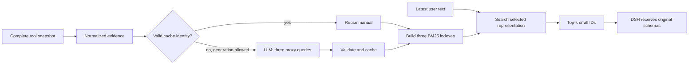

# Configuration

Run `toollery-dsh init path/to/workspace`. Put `.env` next to `toollery.json`. Relative paths resolve against that directory, not the shell's current directory. Installed package resources contain application code; caches, DSH state and reports live in the user workspace.

## Chat: toollery.json

| Field | Default | Meaning |
| --- | --- | --- |
| `model` | `deepseek-flash` | DSH chat model |
| `base_url` | `https://api.deepseek.com/anthropic` | Messages-compatible chat endpoint base |
| `api_key_env` | `TOOLLERY_CHAT_API_KEY` | Variable name, never the secret itself |
| `max_tokens` | `4096` | Chat output budget |
| `request_timeout_seconds` | `180` | DSH request timeout |
| `generator_config` | `manual-generator.json` | Independent generator configuration |
| `cache_dir` | `.toollery/cache` | Persistent manual records |
| `dsh_home`, `web_home` | `.toollery/dsh-cli`, `.toollery/dsh-web` | DSH state |
| `state_dir` | `.toollery/ui-state` | Web settings and audit state |
| `representation` | `spec_manual` | `spec`, `manual`, `spec_manual` |
| `budget` | `top_k` | `top_k` or `all` |
| `k` | `3` | Positive integer; zero-score top-k matches are omitted |
| `tool_sources` | omitted | Omit for demo tools; see integration guide |

Commands accept `--mode`, `--budget`, `--k`. Workers default to 8 (supported range 1–8). `--toollery-off` starts without retrieval. CLI preferences are per launch; Web settings persist for the corresponding agent/session.

The bundled launcher uses DSH's `deepseek-official` provider and ordinary complete-list tool updates. Filling another URL does not add arbitrary protocol support. Use the advanced host integration for another DSH provider, subject to its tool-projection contract.

## Manuals: manual-generator.json

```json
{
  "provider": "command",
  "command": ["{python}", "-m", "toollery_dsh.provider_bridge"],
  "model": "deepseek-flash",
  "parameters": {
    "api_url": "https://api.deepseek.com",
    "api_key_env": "TOOLLERY_MANUAL_API_KEY",
    "temperature": 0,
    "timeout_seconds": 120,
    "retries": 2
  },
  "bridge_version": "openai-compatible-v1-paper-a1",
  "timeout_seconds": 400
}
```

`{python}` becomes the current interpreter. The bridge calls `/chat/completions`; bases ending in `/v1` are accepted. It uses normalized tool evidence and the Appendix A.1 prompt, validating exactly three query/thought entries. Only query text is indexed; thoughts remain in the cache. The count is fixed at three in v0.1.0.

Custom generator commands run with the directory containing `toollery.json` as their working directory, including when the shell is elsewhere. Relative script arguments resolve there. Bare executable names use PATH; explicit relative executable paths (such as `./tools/generator.exe`) resolve there too. `{python}` avoids assuming a `python` command or activated virtual environment. A custom command may omit `parameters.api_key_env` if it does not need an API key; when supplied, that variable is loaded from the config directory `.env`. Windows batch commands use the same argument restrictions as the [host bridge](integration.md).

The generator executable is required only when generation is enabled. Cache-only startup still needs its configuration for cache identity, but does not require the external generator to be installed or its API credentials to be present. Doctor reports generator executable availability as a separate optional check.

## Credentials

```dotenv
# Shared fallback:
TOOLLERY_API_KEY=replace-locally
# Or independent services/accounts:
TOOLLERY_CHAT_API_KEY=replace-locally
TOOLLERY_MANUAL_API_KEY=replace-locally
```

Separate keys override the fallback. Process environment overrides `.env`. A custom variable name must be supplied explicitly; shared fallback applies only to the default two names. Keys travel in child environments, not command arguments. The loader reads only requested variables, without shell evaluation. Do not put secrets in JSON or commit `.env`.

## Startup and updates



Normalization uses description/name/parameters and available documentation, excludes evaluation metadata, and caps evidence at 24,000 characters. Missing descriptions use structured evidence directly, without a separate LLM description-generation stage. Normalized evidence is transient; its hash and source mode are persisted, not its full text.

Cache identity: `format_version`, `tool_id`, `spec_hash`, `evidence_hash`, `normalization_version`, `manual_prompt_version`, `generator`, `proxy_query_count`, `language_policy`. Records add `manual_key`, `manual_hash`, `source_mode`, query/thought entries, usage and creation time. The generator contract includes its command and settings, so changing interpreters or provider configuration can conservatively invalidate entries.

Every startup discovers the current complete pool. Unchanged tools reuse manuals; new tools and changed public schemas need new entries; removed tools leave the new indexes. Old cache files are retained. Diff detection includes description and parameters, not just names. Internal implementation changes with identical schemas are outside this boundary.

An active agent's pool is frozen; runtime changes are rejected and require restart. Missing manuals fail initialization explicitly. Run `prepare` to fill them; no silent spec fallback occurs. `chat --spec-only` is an explicit diagnostic alternative. OFF skips manual preparation and retrieval, exposing original specs. ON/all ranks the pool but retains every tool, including zero-score entries.

Offline runs have separate mock caches. Reports under `.toollery/runs/` can include prompts, tool specs/results and responses; share them only after intentional review/redaction.
