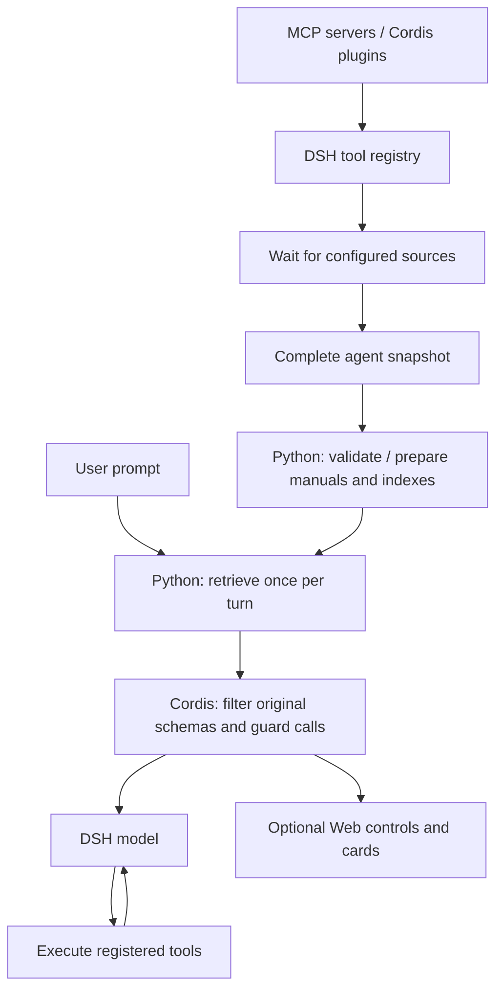

# Tool sources and DSH integration

Toollery has two parts: Python owns normalization, manual cache and retrieval; an external Cordis plugin observes DSH tools, requests a selection, filters schemas and guards calls. No DSH source fork is required.



“Complete” means all tools registered and visible to this agent after configured discovery. The full registry remains intact between turns. Manual generation sees tool evidence, never benchmark queries or labels. Chat receives original specs, never replacement manuals.

## Bundled launcher sources

Set `tool_sources` in `toollery.json`; omit for the demo pool. An empty array is not a custom empty pool. Filesystem requires `setup-web`, including for CLI use:

```json
{"tool_sources": [{"id": "filesystem", "type": "filesystem", "root": "playground"}]}
```

MCP stdio:

```json
{
  "tool_sources": [{
    "id": "myservice", "type": "mcp",
    "config": {"transport": "stdio", "command": "node", "args": ["server.mjs"], "cwd": "."},
    "env_from": {"SERVICE_API_KEY": "MY_SERVICE_API_KEY"}
  }]
}
```

MCP HTTP:

```json
{
  "tool_sources": [{
    "id": "remote", "type": "mcp",
    "config": {"transport": "streamable-http", "url": "https://example.com/mcp"},
    "headers_from": {"Authorization": "MY_MCP_AUTHORIZATION"}
  }]
}
```

Referenced variables belong in `.env` or the environment. Header values must include `Bearer ` when required. Literal MCP `env`/`headers` secrets are rejected. IDs are unique, at most 32 characters, with letters/digits/underscore/hyphen. Names become e.g. `mcp__filesystem__read_text_file`.

Local Cordis plugin:

```json
{"tool_sources": [{"id": "custom", "type": "plugin", "path": "tools/custom.mjs", "config": {}}]}
```

See [demo registration](../toollery_dsh/assets/demo-tools.mjs). Plugins must finish registration by the discovery barrier; arbitrary late asynchronous registration is unsupported. Relative paths use the config directory. Stdio `args` pass through; its `cwd` resolves explicitly. MCP uses the separately installed pinned DSH npm runtime (`setup-web`).

Restart and `prepare` after source changes. Failure aborts initialization rather than running an unfiltered agent.

## Existing DSH host

Bundled `chat`/`web` are the tested user paths. The advanced wrapper injects the bridge/plugin into an existing command while keeping its provider, persona and tools:

```powershell
toollery-dsh init existing-host
# Fill manual-generator.json and .env.
toollery-dsh bridge --config existing-host/toollery.json --generate-manuals -- dsh --profile web --no-open
# Later launches can omit --generate-manuals.
```

The wrapper starts localhost Python, writes a patch, passes bridge URL/token through the environment and appends `--patch`. It configures native tool presentation and inserts Toollery, without demo tools. Optional configured sources are additional to host tools. The child retains its normal DSH provider configuration. This command is explicit opt-in; `--toollery-off` bypasses retrieval.

The child process runs from the directory containing `toollery.json`. Explicit relative executable paths resolve there; bare commands use PATH. The wrapper checks executable availability before starting the bridge. This does not verify the custom host's version or provider compatibility.

This path depends on the custom host/provider. Confirm:

1. Pinned compatible DSH, native tools, no `run_code` projection.
2. Full tool registration before snapshot; use the source barrier for configured sources.
3. Every request presents the **complete current subset**. Addition-only deferred updates fail with disjoint per-turn subsets; bundled launchers disable them for the default model.
4. Host accepts an additional patch and retains Toollery's guard and temporal scope policy.

The wrapper does not install custom-host UI extensions; use bundled `web` for switch/cards. Its generated patch and installed plugin are inspectable for another supervisor. Never publish the per-process bridge token.

On Windows, npm-style `.cmd`/`.bat` shims run with Command Processor AutoRun and delayed expansion disabled, preserving the configured working directory. Arguments containing a literal double quote, percent sign or newline require invoking the underlying executable directly, such as `node path/to/dsh-entry.js`. This wrapper launch check does not certify an arbitrary host's tool-discovery or provider behavior.

## Per-turn scope

Current user text chooses a subset once; all model/tool steps in that turn retain it. The next turn searches the full preserved pool. DSH keeps previous calls/results, and a scope policy distinguishes past availability from current callable tools.

Retrieval still ignores conversation history. “Yes, do that” can miss tools; dependencies are not expanded. v0.1 has no retry-time recovery search.
