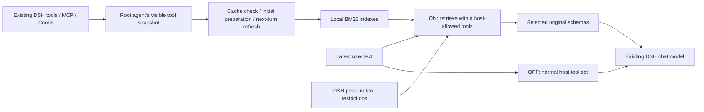

# Existing DSH plugin installation

The v0.2 plugin is an official-format DSH bundle. The standalone Windows launcher remains available as a separate demo. Installing the plugin does not install DSH again or replace an existing profile.

## Install

The local target is **DSH Desktop 0.12.1**, with a working chat model and **native tool presentation** (Standard preset); its DSH runtime is pinned separately to **0.2.1-rc.2**. Desktop supplies Node and its package manager for plugin installation; no separate terminal or Node/pnpm installation is required. The plugin does not copy or change the chat model's credentials. The Desktop GUI onboarding path remains unverified; see [verification](verification.md).

### Recommended: install by package name

Open **Plugins → Add plugin → Install a third-party plugin** and enter:

```text
@jkl-agents/dsh-toollery
```

DSH uses its configured npm registry and installs the published plugin bundle. This is the normal Desktop path and does not require a terminal, a downloaded archive or a second DSH installation. The package name is the stable installation identifier.

### Pinned or offline install

Download the matching `.tgz` asset from the [latest GitHub release](https://github.com/JKL-agents/toollery-dsh/releases/latest). Enter its release URL or downloaded file's **absolute path** in the same dialog.

1. Open **Plugins → Add plugin → Install a third-party plugin**. Enter the downloaded bundle's **absolute path**, such as `C:\Users\you\Downloads\jkl-agents-dsh-toollery-0.2.1.tgz`, or its release asset URL. Install, enable and restart if requested.
2. Open Toollery's plugin details. Select **Set up local worker**. Windows x64 users without Python can first check **Allow private Python download if needed**. The status shows setup stages; the first runtime download may take several minutes. No model calls occur during setup.
3. In **Manual-generation model**, save your model, OpenAI Chat Completions-compatible API base URL and key. Defaults are `deepseek-flash` and `https://api.deepseek.com`. Saving checks cache readiness without generating manuals.
4. Start a **new native conversation**. Its Toollery panel shows the full pool and valid/missing manual counts. If DSH is still showing its new-chat landing page, send a harmless greeting to create the session; Toollery remains OFF until ready, and that greeting uses your normal chat API. Check the API/charges confirmation, then select **Generate missing manuals (uses API)**. Tool specifications are sent to the chosen manual provider. Three proxy queries are generated per tool; retries can add requests. Progress is shown while preparation runs.
5. When ready, try a prompt using your existing tools. Inspect selected/called tools, change k, or switch OFF. The plugin adds no toy/demo tools to your agent.

No `.env` editing or standalone launcher is required. Chat remains usable with Toollery OFF while setup is incomplete. An explicit OFF choice remains OFF after preparation; otherwise successful preparation enables the default ON / `spec_manual` / top-k / k=3 configuration.

### CLI alternative and environment

In a terminal using your existing CLI installation:

```powershell
dsh plugin --profile web add @jkl-agents/dsh-toollery
dsh --profile web
```

For a pinned offline CLI install, replace the package name with the downloaded `.tgz` path.

Replace `web` with your existing CLI profile name. Desktop uses an application-owned profile; `--profile desktop` does not select it. Use the normal authenticated DSH URL and workspace/model configuration. The bundle has no npm lifecycle/build scripts; DSH's package manager installs it from npm. The CLI requires its supported Node (22.19+ on 22.x, or 24+) and pnpm environment; Desktop supplies its own.

On DSH Desktop, setup first uses the Desktop-injected absolute path to its installation-owned `office-runtime/primary-runtime` Python. Toollery creates a profile-local venv with that interpreter and installs the embedded worker wheel offline; Desktop's runtime intentionally omits `ensurepip`, so this path uses the bundled pip with `venv --without-pip` and never writes into the Desktop installation. If that payload is unavailable, setup tries version-checked `py -3.12`, `py -3`, then `python` on Windows; Unix uses `python3`, then `python`. Existing Python must be 3.12+ with venv/pip. Alternatively set an absolute `TOOLLERY_PYTHON` path before starting DSH. `/toollery setup` uses existing Python only; private-runtime download consent is provided through the UI.

If explicitly allowed on Windows x64 and no system Python is found, setup downloads pinned uv from GitHub, verifies SHA-256 and installs private Python 3.12.12 under the profile. It does not modify global PATH or system Python. This needs GitHub access and the Windows network/proxy configuration; Windows PowerShell handles the initial download. Other operating systems/architectures require preinstalled Python. An invalid explicitly configured Python path must be corrected instead of silently replaced.

The bundle reuses DSH's Cordis/LLM host services with optional peers. Installation may need registry access through DSH. Once Python exists, installation of the embedded worker wheel is offline with no index/dependency resolution. The profile must be writable; child processes and loopback connections must be allowed. There is no IDE runtime fallback or fixed worker port.

Setup verifies that the worker is installed inside the private venv. Worker and built-in provider imports ignore the current directory, `PYTHONPATH` and Python user packages. Setup also ignores user pip configuration/environment overrides. Explicit custom generator commands retain their own environment requirements.

The plugin starts OFF until manuals are ready. With a complete valid cache it automatically becomes ready on later launches. An explicit per-session OFF choice is retained. DSH chat remains usable while setup is incomplete.

## Provider-owned discovery batches

An optional provider can use the plugin as a local retrieval service when it has fetched a batch of possible tools from its own catalog:

```js
const result = await service.rankCandidates(
  agent.id,
  userPrompt,
  candidateBatch,
  { representation: 'spec_manual', budget: 'top_k', k: 3, requestId: 'discovery-42' },
)
```

The provider owns remote discovery, authentication, executor references and DSH registration. Toollery accepts only the model-facing `name`, `description`, `parameters` and optional `output` fields, stores those schemas in `discovery-catalog.json`, reuses or generates three-query manuals, and returns structured `selected[]` entries plus ranking/report data. Each entry contains the candidate's `tool_id`, an opaque provider-supplied `candidate_ref` when available, the `spec_hash`, and the retrieval score; the response also binds the result to `request_id` and `candidate_snapshot_hash`. `selected_names` remains a compatibility field. `discoverCandidates` is an alias. A candidate batch is limited to 256 unique candidate IDs and is never merged into the host registry, current session snapshot, or current turn selection. The provider should use the structured identities, then recheck the candidate snapshot, schema hash, permissions and executor availability before exposing or executing a selected tool. A selected ID is a retrieval suggestion, not an execution grant.

Manual generation is guarded by the same preparation lock as normal preparation and is cache-addressed. If the missing count exceeds `maxAutoTools` (default 15), the result is `approval_required`; retry with an explicit generation policy. Discovery requests use a longer bridge timeout, but a caller timeout does not cancel the worker job. Retrying the same candidate snapshot reuses the in-progress or completed job, preventing duplicate generation calls.

## Configure and prepare

Files in `<current profile directory>/toollery/`:

| File/directory | Purpose |
|---|---|
| `manual-generator.json` | Manual model, endpoint, driver and generation settings |
| `manual-credentials.json` | API key saved by the UI; never returned to the browser |
| `.env` | Optional manual API key for advanced configuration |
| `settings.json` | Defaults: representation, budget, k, workers (1–8), enabled, refresh_max_misses (15) |
| `worker.json` / `venv/` | Locally installed Python worker |
| `runtime/` | Optional private uv/Python/download cache on Windows x64 |
| `cache/` | Content- and generation-contract-addressed manual entries |
| `sessions/` / `runs/` | Session settings and local tool/preparation observations |
| `overrides/` | Explicit OFF choices, usable even without the worker |

Use the plugin form for normal setup. The key is stored in a local file under the profile, inheriting its Windows ACL (user-only permissions on Unix), **not an OS keychain**. The browser receives only a key-configured boolean. A blank key retains the saved/environment key. A saved UI key takes precedence over environment/`.env` keys; to return to environment credentials, stop DSH and remove `manual-credentials.json`.

Changing only the key preserves manual/cache identity. Changing model or endpoint rechecks current session caches without paid generation; prepare missing/stale entries explicitly. Saving is blocked while preparation is running. These UI changes take effect without restarting DSH. Replacing a custom command with the built-in API generator is identified in the form.

Advanced users can edit `manual-generator.json` and create `.env` in the **shown configuration directory**:

```dotenv
TOOLLERY_MANUAL_API_KEY=your-manual-generation-key
```

DSH continues using its own chat configuration and credentials. They can belong to a different provider/model. Toollery does not read or change DSH's chat settings. See [configuration](configuration.md) for the generator contract and cache identities. Do not commit local configuration containing credentials.

Select **Generate missing manuals (uses API)** or send `/toollery prepare`. This explicitly permits generation API calls for missing/stale tools. Worker concurrency defaults to 8, adjustable from 1 to 8 in `settings.json` before starting DSH. Install, setup and cache checks do not generate manuals. Cache misses are visible; there is no silent spec-only fallback. After manually editing generator/settings files, restart DSH so readiness is revalidated, then prepare if needed.

After successful preparation the plugin defaults to ON / `spec_manual` / top-k / k=3. If you explicitly switched OFF while preparation was running, it stays OFF. Use `/toollery on` when ready. Setup/preparation progress appears in the Web controls; terminal users can poll `/toollery status`.

### Changes during a conversation

At the first model assembly of a new user turn, Toollery compares the agent's current visible registry with its committed snapshot. Removals and fully cached changes need no generation. For `manual`/`spec_manual`, up to `refresh_max_misses` uncached tools can be generated automatically (default 15); this counts cache misses, not changed tool names. The policy uses the saved manual provider and can send newly visible schemas to it. Set the limit to 0 to require explicit approval for every new manual. `spec` refreshes need no manuals. OFF performs no generation and preserves normal host tool visibility.

Above the limit, the turn reports `approval_required`. Approve in the Toollery panel or run `/toollery prepare`, wait until ready, then **resubmit the original message**. Approval applies to the pending new snapshot. A failed refresh retains that target for retry. There is no automatic message replay or automatic switch to OFF.

The panel shows completed/total tools, elapsed time and approximate remaining time. ETA uses actual uncached-tool completions; cache hits do not inflate its rate. Before the first completion it shows **estimating remaining time**. Small batches, retries, provider load and the final index build make ETA approximate.

The default refresh wait is **120 seconds**, configurable through the Cordis plugin option `refreshTimeoutMs` in milliseconds (1,000–1,800,000). This is the request's wait budget, not the provider timeout. If exceeded, the turn returns `refresh_pending`; the worker retains the generation job and later matching requests reuse it. Timeout/abort does not guarantee cancellation of a provider request or its charges. Ordinary bridge operations retain a 15-second timeout; initial preparation runs as a background job. A pool changing during refresh is retried at most once; continued changes report `unstable_tool_pool`.

Only validated snapshot/index state is committed, with revision checks and a host-pool recheck before selection. Full BM25 indexes are rebuilt after a refresh; incremental indexing is not implemented. Within one worker, preparation is serialized and repeated refreshes reuse the active job. Across worker processes, a cache-key lock conflict fails retryably rather than starting a duplicate call: wait for the owner, then retry to reuse its result. Remove a stale lock only after confirming its owner has stopped.

## Runtime behavior



Modes `spec`, `manual`, `spec_manual` affect local retrieval documents. `top_k` limits positive-scoring hits to k; fewer hits are valid. `all` retains all host-allowed tools, including zero-score tools. Manuals are never sent as tool declarations. Each turn freezes its settings and selection through subsequent tool calls. OFF preserves restrictions imposed by DSH/other plugins; it does not restore tools the host has denied.

The assembly middleware runs after downstream tool restrictions resolve, so top-k is chosen within that allowed set. A plugin that later changes/reintroduces tools, or prepends another interceptor with different ordering assumptions, requires separate assessment. The local coexistence check covers an independent restrictive tool policy and prompt/stream middleware.

The cache/index universe comes from `ctx.tools.schemas(agent)`; the eligible subset comes from downstream `assembled.tools`. Restricted but visible tools can therefore be cached without becoming callable. Toollery does not modify the host registry or remove host restrictions. Selection is an intersection with the current assembled tools, including on later model steps.

DSH's default addition-only tool-history projection can otherwise retain old declarations. For managed native sessions, a scoped `llm/stream` middleware re-enters the public stream API with an immutable request copy omitting `toolHistory`; DSH then sends the current declarations. Original messages and persisted history remain intact. The host's model configuration is not overwritten. Downstream stream middleware/provider dispatch once; adapter metadata may be resolved again. Plugins relying on earlier stream interception or dynamic adapter changes during request preparation require separate assessment. This is a version-pinned compatibility boundary, not a claim of universal plugin compatibility.

## Boundaries and lifecycle

- The snapshot covers tools registered and visible when the root agent is created. It is not every tool potentially discoverable from every remote source. Configure/finish loading sources before creating the conversation.
- Native root agents only. PTC is visibly unsupported; subagents retain normal DSH behavior.
- Settings and selection are frozen per user turn. Additions/schema changes reconcile on the next turn; tools unloaded during a turn are not revived by its frozen selection. Executable behavior changes with identical specs cannot be detected.
- Cache identity handles new/changed evidence; matching entries are reused. Old entries are not automatically deleted. Toollery observes sources already registered by DSH; it does not reload a source that the host has not refreshed.
- Provider-owned discovery is an optional ranking API, not an autonomous discovery loop. External batches use an ephemeral index and shared cache without changing the active selection. Same-turn model-facing additions would need a separate explicit selection-epoch transition and are not implemented.
- Latest-text retrieval can omit dependency/follow-up tools. Increase k or turn OFF. These limitations are unchanged by packaging; [experiment evidence](experiments/README.md) is from the earlier standalone integration.
- Disable/remove the bundle through DSH's Plugins page or `dsh plugin --profile web remove @jkl-agents/dsh-toollery`. If DSH reports restart-required, restart to finish unloading. The worker, guards, prompt sections and UI routes are plugin-owned and cleaned up on unload. Cache/configuration persist.
- If the worker fails while ON, the turn reports an error. The status UI still allows OFF, which bypasses retrieval without needing the worker. Keys/bridge token are not exposed to the browser. Local runs may contain prompts, tool specifications and results metadata.
- Complete any preparation before disabling/removing. An interrupted generation may incur already-started API charges; completed cache entries are reusable. A crashed setup can leave `setup.lock`; after confirming DSH/setup has stopped, remove that directory and retry setup.

## Upgrade and source builds

Install the new release bundle through the same profile, restart DSH, then run `/toollery setup` to update the embedded worker. A missing/mismatched saved worker version requests setup instead of silently running an old worker. Repeated setup reinstalls the bundled wheel while preserving configuration and cache. Do not delete the profile cache. Incompatible/missing cache entries require explicit preparation.

Maintainers can build the artifact without Node compilation:

```powershell
python -m pip install '.[dev]'
python scripts/build_plugin.py --build-wheel
```

This stages shared JavaScript/UI assets and the worker wheel under `build/plugin`, then emits `dist/jkl-agents-dsh-toollery-<version>.tgz`. The same generated package is published to npm as `@jkl-agents/dsh-toollery`; generated copies are not maintained as separate source implementations.
